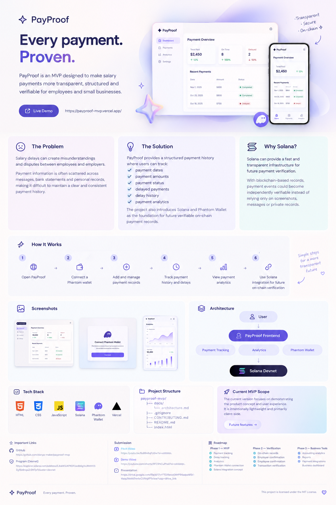

#  PayProof
### Every payment. Proven.

Salary transparency for employees and small businesses — built with Solana.

>  Project Status: Prototype / MVP demo
>
> PayProof is currently a working frontend prototype using sample salary-payment data to demonstrate the product vision. The Solana Anchor program exists and is deployed to Devnet, but the frontend-to-chain integration is still in progress. Real on-chain salary recording and verification are planned for Phase 2.

<p align="center">
  <a href="https://payproof-mvp.vercel.app/">
    
  </a>
  <a href="https://youtube.com/shorts/9FC9NCuPhs0">
    
  </a>
  <a href="https://colosseum.com/arena/projects/payproof">
    
  </a>
</p>

<p align="center">
  
</p>

<p align="center">
  <strong>Track salaries. Monitor delays. Build trust.</strong>
</p>

---

##  About the Project

Salary information is often scattered across messages, screenshots, and spreadsheets. Repeated payment delays can be difficult to track and document.

PayProof brings salary payment records into one dashboard, helping employees and small businesses organize payment history, monitor delays, and understand payment patterns.

##  Key Features

| Feature | Description |
|---|---|
| Dashboard | View payment records and key statistics |
| Payment History | Review payment amounts, dates, and statuses |
| Delay Monitoring | Track delays and identify recurring patterns |
| Analytics | Explore payment history through dashboard statistics |
| Solana Foundation | Anchor program deployed to Solana Devnet |

## Try PayProof

<p align="center">
  <a href="https://payproof-mvp.vercel.app/">
    <strong>🌐 OPEN LIVE DEMO</strong>
  </a>
  &nbsp; · &nbsp;
  <a href="https://youtube.com/shorts/9FC9NCuPhs0">
    <strong>▶ WATCH VIDEO</strong>
  </a>
</p>

The prototype uses sample payment data to demonstrate the user experience.

##  Solana Devnet

PayProof includes an Anchor program deployed to Solana Devnet.

| Detail | Value |
|---|---|
| Network | Solana Devnet |
| Framework | Anchor |
| Language | Rust |
| Program ID | EJkAW3JKPKDFUw3b6gVvJMnhY21CR9qg7a8nqaZrZM7p |

[View Program on Solana Explorer →](https://explorer.solana.com/address/EJkAW3JKPKDFUw3b6gVvJMnhY21CR9qg7a8nqaZrZM7p?cluster=devnet)

> Prototype status: The website currently uses sample payment data. The deployed Anchor program is not yet connected to the frontend for real on-chain salary-payment recording or verification.

##  Why Solana?

- Low fees — a potential fit for recording individual payment events.
- Fast confirmation — supports responsive transaction workflows.
- Anchor framework — provides tools for building Solana programs in Rust.
- Verifiability — future on-chain records could help users independently verify payment events.

These are the capabilities PayProof aims to build on as development continues.

##  Tech Stack

<p>
  
  
  
  
</p>

##  Architecture

PayProof consists of two main components:

1. Frontend — dashboard, payment history, delay monitoring, and analytics.
2. Solana program — deployed Anchor program intended to support future on-chain payment records.

The frontend-to-program integration remains future work.

📖 [Read the Architecture Documentation](docs/architecture.md)

##  Repository Structure

```text
payproof-mvp/
├── .github/
│   └── workflows/
│       └── build.yml
├── docs/
│   ├── architecture.md
│   └── payproof-overview.png
├── programs/
│   └── payproof/
│       ├── src/
│       ├── Cargo.toml
│       └── ...
├── .gitignore
├── Anchor.toml
├── Cargo.toml
├── LICENSE
├── README.md
├── index.html
├── package.json
├── script.js
├── style.css
└── tests/
    └── payproof.ts
```

##  Roadmap

- [ ] Connect the frontend to the deployed Anchor program.
- [ ] Implement and test on-chain payment recording.
- [ ] Add transaction confirmation and verification links.
- [ ] Improve wallet connection and error handling.
- [ ] Expand automated tests and validation.

##  Hackathon & Contact

2026 Solana National Hackathon

- Founder & Developer: Rayana
- Colosseum Project: [PayProof](https://colosseum.com/arena/projects/payproof)
- Telegram: [@runmein](https://t.me/runmein)

## 📄 License

Released under the MIT License. See [LICENSE](LICENSE).
